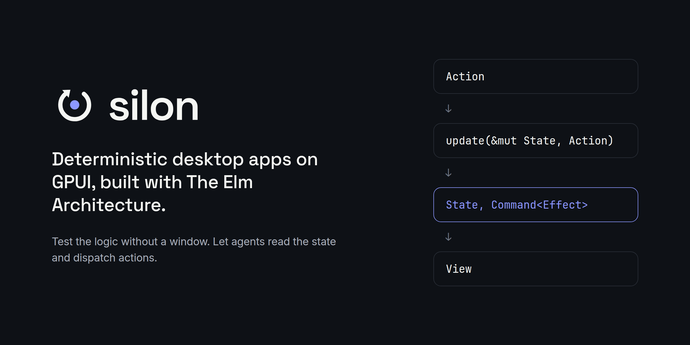

<p align="center">
  
</p>

[](https://github.com/chansuke/silon/actions/workflows/ci.yml)
[](#license)
[](CONTRIBUTING.md)

A deterministic desktop application framework on top of
[GPUI](https://www.gpui.rs/), using The Elm Architecture. Business logic is a
pure `update` function that tests run without a window, and a running app can
expose its state and actions to coding agents over HTTP or MCP.

## Crates

| Crate | What it holds |
| --- | --- |
| `silon-core` | `Feature`, `Command`, `EffectRunner`, `TestHarness`. No GPUI, no IO. |
| `silon-gpui` | `Store`, `Dispatcher`, `FeatureView`, `FeatureRoot`. |
| `silon-introspect` | The HTTP API, behind the `introspect` feature of `silon-gpui`. |
| `silon-mcp` | An MCP server over stdio that forwards to the HTTP API. |
| `silon-ui` | Theme tokens and primitives. The `components` feature adds `TextInput`. |

The architecture rules are in [AGENTS.md](AGENTS.md).

## Build and run

```sh
nix develop
cargo test --workspace --all-features
cargo run -p counter-app --features introspect   # HTTP API on 127.0.0.1:3737
```

`herdboard-app` shows the terminals of a running
[herdr-core](https://github.com/herdrdev/herdr-core). Click a live terminal's
screen to type into it.
Pass the socket path as the first argument, or it uses `HC_SOCKET` or the default
path of the `HC_SESSION` session.

`terminal-app` is a terminal: your shell in a PTY, with
[libghostty-vt](https://ghostty.org) as the VT emulator and Silon for the
window. On Linux it builds libghostty-vt with Zig 0.17, which the dev shell
provides.

On a Linux distribution other than NixOS, GPUI cannot find the host's Vulkan
drivers from the Nix shell. Use nixGL, or Mesa's software renderer:

```sh
export VK_DRIVER_FILES=$(nix build --no-link --print-out-paths nixpkgs#mesa)/share/vulkan/icd.d/lvp_icd.x86_64.json
```

## Introspection

```sh
curl http://127.0.0.1:3737/state/counter
curl -X POST http://127.0.0.1:3737/dispatch/counter -H 'Content-Type: application/json' -d '"Increment"'
curl 'http://127.0.0.1:3737/replay/counter?through=3'
```

To use it from an agent, register `silon-mcp`, for example with Claude Code:

```sh
cargo build -p silon-mcp
claude mcp add silon -- "$PWD/target/debug/silon-mcp"
```

## Contributing

Silon does not accept pull requests. Bug reports are welcome as issues. See
[CONTRIBUTING.md](CONTRIBUTING.md) and [SECURITY.md](SECURITY.md).

## License

[0BSD](LICENSE). You can use, copy, modify and distribute Silon without
attribution.
